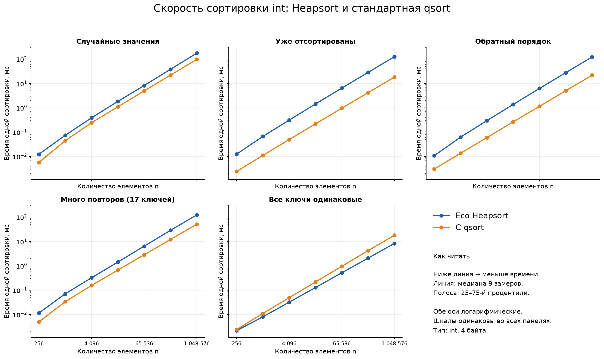
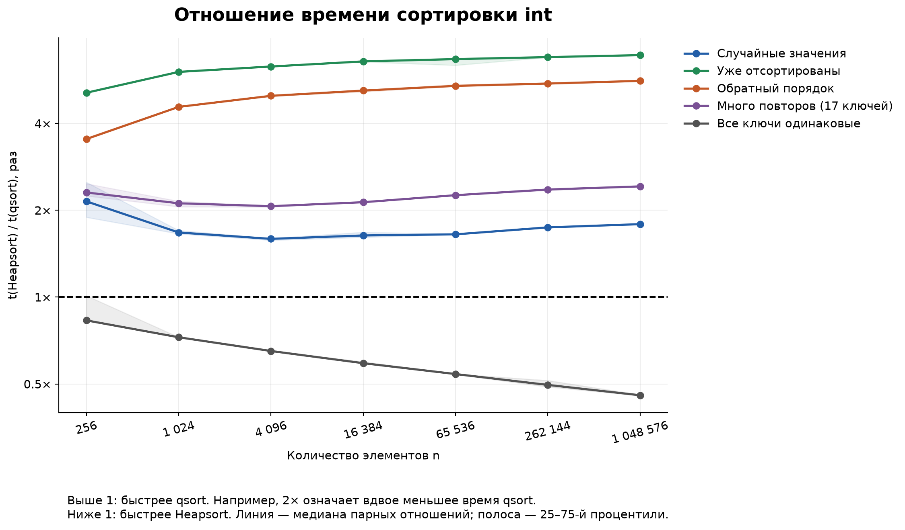
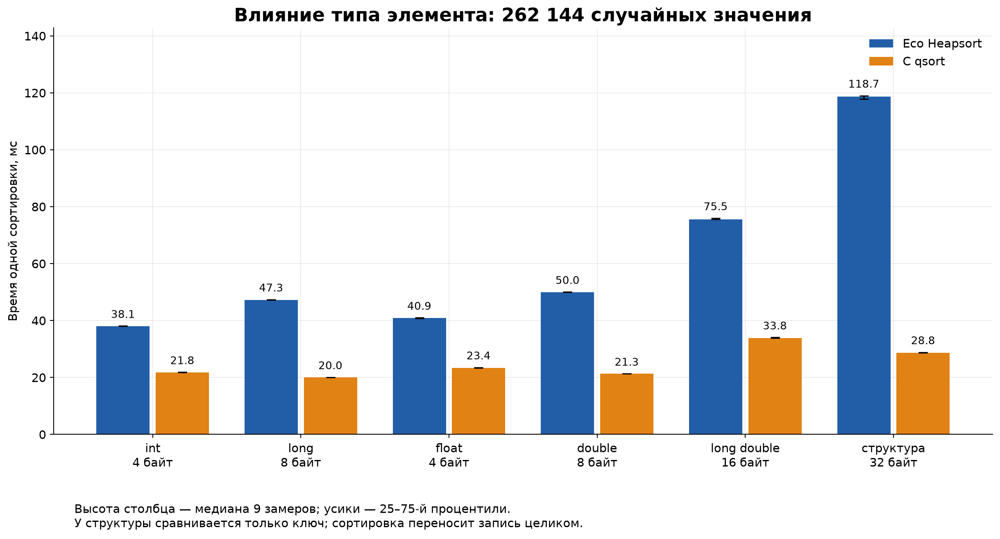
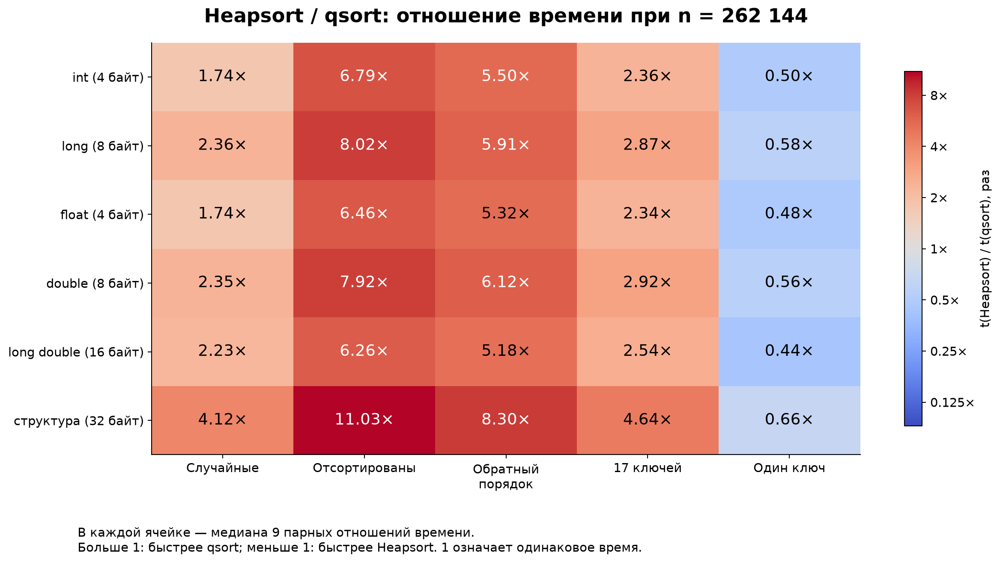

# Анализ производительности EcoHeapSort и qsort

Задание № 60: пирамидальная сортировка. Эксперимент выполнен отдельно от компонента и обязательного UnitTest. Этот материал покрывает анализ времени сортировки для отчётности; он не заменяет полный отчёт по компоненту.

## 1. Стенд и сравниваемые реализации

| Параметр | Значение |
| --- | --- |
| Дата (Москва) | 2026-10-10T18:55:37.172923+03:00 |
| Процессор | Intel(R) Core(TM) i9-10900F CPU @ 2.80GHz |
| Система | Linux-7.2.4-arch1-2-x86_64-with-glibc2.44 |
| Библиотека C | glibc 2.44 |
| Компилятор | x86_64-linux-gnu-gcc (Eco.GNU.Distribution x86 linux64 v13.2.0) 13.2.0 |
| Конфигурация | Release, -O2; компонент -ffreestanding -fno-builtin |
| Закреплённый логический CPU | 0 |
| Таймер | clock_gettime(CLOCK_MONOTONIC_RAW), наносекунды |

Heapsort вызывается через настоящий IEcoSortAndSearch, полученный через QueryComponent, и берётся из Release-архива проекта. Эталон — qsort установленной библиотеки C. Обе реализации получают один и тот же компаратор. Название qsort не гарантирует конкретный внутренний алгоритм: стандарт C задаёт поведение, а реализация зависит от библиотеки и её версии.

## 2. Методика измерений

Пять сценариев: случайные значения, уже отсортированный массив, обратный порядок, 17 различных ключей, все ключи одинаковые. Типы: int, long, float, double, long double и структура из 32 байт (ключ, уникальный id и 24 байта полезных данных). NaN не используются; дробные значения кратны 0,25 и представимы точно.

Размеры: 256, 1 024, 4 096, 16 384, 65 536, 262 144; для int также 1 048 576. Итого 185 сценариев, 9 парных замеров на сценарий — 1 665 пар, или 3 330 измерений времени (часть — серии сортировок). Внутри этих измерений выполнено 24,390 вызовов сортировки без учёта прогрева. Перед каждой сортировкой восстанавливается исходный массив. Генерация, выделение памяти, копирование, проверки и создание Eco-компонента не входят в измеряемое время.

Перед замерами выполнена одна прогревочная пара. Порядок запуска Heapsort/qsort чередуется. Для n < 8 192 измеряется серия независимых сортировок свежих копий: время серии делится на число сортировок. Для остальных размеров измеряется одна сортировка. Зафиксирован воспроизводимый seed; процесс закреплён за одним доступным CPU. На графиках приведены медианы и интерквартильные диапазоны (25–75-й процентили), которые показывают разброс, а не доверительный интервал.

В пределах одного сценария оба алгоритма и все повторы получают одинаковые входные данные. Случайный seed зависит от типа и размера: между типами сравниваются одинаковые распределения, но разные конкретные последовательности. График типов поэтому показывает стоимость на выбранных выборках, а не изолированное влияние одного размера элемента.

После каждого запуска проверяется порядок. Для числовых типов результат побайтово сопоставляется с qsort. Для структур проверяются порядок ключей, уникальность id и точное совпадение всей записи с исходной по id; порядок равных ключей может различаться. Все проверки завершились успешно, код клиента — 0.

## 3. Численные результаты

Отношение R = t(Heapsort) / t(qsort). R > 1 означает преимущество qsort; R < 1 — преимущество Heapsort. В таблицах R — медиана отношений внутри пар, поэтому она может слегка отличаться от частного двух отдельно вычисленных медиан времени.

| int, n = 1 048 576 | Heapsort, мс | qsort, мс | R |
| --- | --- | --- | --- |
| Случайные значения | 175.251 | 97.732 | 1.79 |
| Уже отсортированы | 125.581 | 18.222 | 6.90 |
| Обратный порядок | 122.356 | 21.827 | 5.62 |
| Много повторов (17 ключей) | 123.979 | 51.284 | 2.42 |
| Все ключи одинаковые | 8.342 | 18.211 | 0.46 |

| Случайные, n = 262 144 | Байт | Heapsort, мс | qsort, мс | R |
| --- | --- | --- | --- | --- |
| int | 4 | 38.093 | 21.849 | 1.74 |
| long | 8 | 47.271 | 20.026 | 2.36 |
| float | 4 | 40.900 | 23.408 | 1.74 |
| double | 8 | 50.032 | 21.323 | 2.35 |
| long double | 16 | 75.535 | 33.804 | 2.23 |
| структура | 32 | 118.686 | 28.751 | 4.12 |

## 4. Графики и их интерпретация

Рисунок 1. Время сортировки int в пяти сценариях. Обе оси логарифмические; шкалы панелей одинаковы. Чем ниже линия, тем быстрее сортировка. Полосы показывают разброс центральных 50% замеров.

Рисунок 2. Отношение времени Heapsort/qsort для int. Горизонтальная линия 1 соответствует равному времени. Например, значение 2 означает, что qsort заняла вдвое меньше времени.

Рисунок 3. Сравнение типов на случайных данных при одинаковом числе элементов. Столбцы показывают миллисекунды; размер элемента подписан отдельно. Различия включают стоимость компаратора и переноса элемента.

Рисунок 4. Сводное отношение времени для всех типов и сценариев при n = 262 144. Числа в ячейках дают прямую интерпретацию; цветовая шкала логарифмическая.

## 5. Выводы по фактическим измерениям

На случайном массиве из 1 048 576 int быстрее qsort: отношение времени соответствует преимуществу примерно в 1.79 раза. Медиана Heapsort — 175.251 мс, qsort — 97.732 мс.

Уже отсортированы: Heapsort 125.581 мс; qsort 18.222 мс; медианное парное отношение R = 6.90.

Обратный порядок: Heapsort 122.356 мс; qsort 21.827 мс; медианное парное отношение R = 5.62.

Много повторов (17 ключей): Heapsort 123.979 мс; qsort 51.284 мс; медианное парное отношение R = 2.42.

Все ключи одинаковые: Heapsort 8.342 мс; qsort 18.211 мс; медианное парное отношение R = 0.46.

На одинаковых ключах текущий Heapsort может выигрывать: в восстановлении кучи сравнение родителя с ребёнком сразу завершает проход при равенстве. Поэтому в таком специальном случае нет длинных спусков, и фактическая работа близка к линейной по числу элементов. Это объяснение поведения собственного кода; внутренние операции qsort в эксперименте отдельно не подсчитывались.

По медианному парному отношению Heapsort быстрее в 32 из 185 сценариев, qsort — в 153. Это число описывает именно выбранную сетку данных и не является универсальной оценкой алгоритмов.

Увеличение времени с ростом n согласуется с обработкой всё большего массива. Сам эксперимент не доказывает асимптотическую сложность. Для текущей реализации Heapsort O(n log n) сравнений и O(1) дополнительной памяти следуют из построения кучи и итеративного восстановления. При переменном размере элемента побайтовые обмены добавляют множитель size к стоимости перемещения. Структуры и long double поэтому могут иметь иную цену сортировки, чем int.

Причины различий во времени в этом опыте не измерялись отдельно. На них влияют число сравнений, доступ к памяти, размер элемента, компаратор и внутренняя реализация qsort. Графики фиксируют результат сравнения готовых реализаций; они не позволяют приписать весь разрыв одному фактору.

## 6. Ограничения и воспроизводимость

Измерен один компьютер и одна версия libc. Закрепление CPU не отключает Turbo Boost, изменение частоты, фоновые процессы или активность соседнего SMT-потока. Межквартильный диапазон не охватывает все выбросы. Малые массивы измерены сериями на предварительно скопированных данных; это отличается от холодного запуска. Стоимость выделения памяти внутри qsort, если она есть, входит во время вызова. Пиковая память и аппаратные счётчики не измерялись.

Все сценарии относятся к возрастанию и согласованным компараторам; NaN, пользовательские дорогие компараторы и другие распределения не исследованы. Стабильность не требуется. Выводы о скорости относятся к этим реализациям в Release на указанном стенде; их нельзя автоматически переносить на другую библиотеку C, архитектуру или Debug.

Перезапуск: make -C ComparisonFiles run; затем python3 ComparisonFiles/plot.py с установленным Matplotlib из ComparisonFiles/requirements.txt. Исходные измерения: results/raw.csv. Все 185 агрегированных строк: results/summary.csv. Данные стенда, seed и SHA-256 исходников/архива/исполняемого файла: results/environment.json. Графики доступны в PNG, SVG и PDF. libc используется только отдельной программой сравнения; исходники компонента и обязательного UnitTest не изменены.
